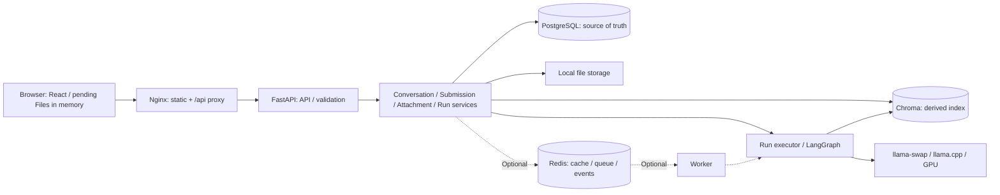
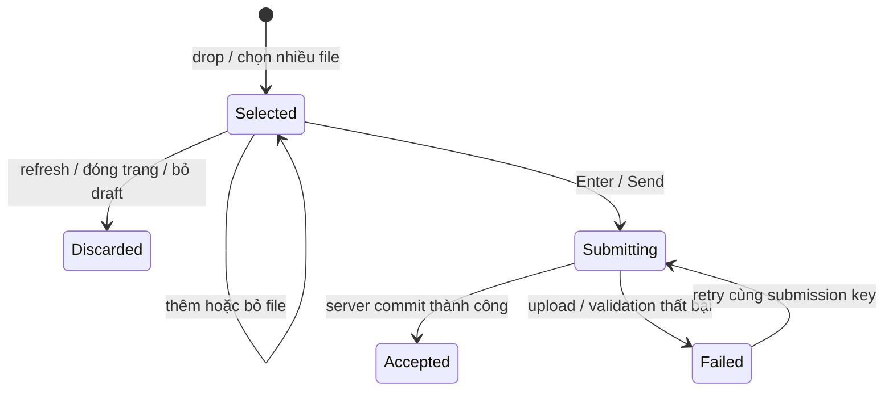

# LocalMind — Rework Architecture & System Design

Ngày: 2026-10-16. Trạng thái: đề xuất thiết kế, chưa phải mô tả implementation đã hoàn thành.

Tài liệu này là cơ sở để rework LocalMind theo từng giai đoạn. Phần “hiện tại” được đối chiếu với code trong repo; phần “mục tiêu” là yêu cầu và quyết định thiết kế cho lần rework. Các giới hạn, TTL và chỉ tiêu hiệu năng dưới đây là giá trị khởi điểm cần kiểm chứng, không phải kết quả benchmark.

## 1. Mục tiêu và phạm vi

LocalMind là ứng dụng hội thoại dùng LLM local, hỗ trợ nhiều model GGUF, tài liệu cá nhân và thử nghiệm scaling test-time compute. Đối tượng chính vẫn là một người dùng trên máy cá nhân, triển khai bằng Docker Compose.

Mục tiêu rework:

1. Chuyển frontend sang ReactJS, Vite và Tailwind; giao diện đơn giản, thao tác ổn định.
2. Sửa quản lý state, request và lịch sử chat để không mất bản nháp hoặc cập nhật nhầm hội thoại.
3. Thiết kế lại hoàn toàn vòng đời file: chỉ upload khi người dùng gửi tin nhắn.
4. Chuẩn hóa API, trạng thái tác vụ, dữ liệu và xử lý lỗi phục vụ frontend mới.
5. Giữ inference và dữ liệu hội thoại ở local; làm rõ các tính năng cần mạng.
6. Chuẩn bị khả năng mở rộng bằng cache, Redis và worker khi có nhu cầu thực tế.
7. Visualize trực tiếp quá trình sinh ứng viên và tournament ranking để thể hiện implementation nghiên cứu; mọi kết quả hiển thị phải xuất phát từ sự kiện thực của backend.

Không thuộc phạm vi phiên bản đầu: tài khoản nhiều người dùng, chia sẻ công khai, SaaS, thanh toán, Kubernetes, cụm GPU phân tán và semantic response cache.

## 2. Hiện trạng hệ thống

### 2.1. Thành phần và trách nhiệm

| Thành phần | Implementation hiện tại |
|---|---|
| Frontend | `src/frontend/index.html`, `app.js`, `app.css`; JavaScript thuần, một state chung, render DOM thủ công |
| Backend | FastAPI trong `src/backend/app.py`; routes → services → CRUD |
| Database | PostgreSQL, SQLAlchemy async; tạo bảng bằng `Base.metadata.create_all` |
| AI orchestration | LangGraph: `setup → generate → tournament_select` |
| Inference | `ChatOpenAI` gọi endpoint OpenAI-compatible của llama-swap; llama.cpp chạy GGUF |
| RAG | MiniLM embeddings, Chroma persistent, parser tài liệu và text splitter |
| Lưu file | `.uploads/files`; vector trong `.uploads/chroma` |
| Model registry | GGUF trong `src/backend/ai/llms/cpp_models`, metadata PostgreSQL, cấu hình `llama_swap_config.yaml` |
| Triển khai | Docker Compose: PostgreSQL, llama-swap, backend, Nginx frontend |

### 2.2. Tính năng hiện có và hướng xử lý

| Tính năng | Hiện trạng | Hướng rework |
|---|---|---|
| Hội thoại | Tạo, liệt kê, đổi tên, xóa; lưu tin nhắn | Giữ tính năng; thêm phân trang, thứ tự ổn định, state theo conversation |
| Chat local | Chọn model GGUF, gửi câu hỏi và nhận JSON hoàn chỉnh | Giữ; tách gửi tin nhắn khỏi vòng đời inference bằng run |
| Reasoning | Low/Medium/High/Extra sinh 1/3/5/7 ứng viên, tournament hiện cố định tối đa 3 ứng viên/lượt | Giữ số ứng viên theo mode; bổ sung group size tùy chỉnh, mặc định 3, visualize bracket thực |
| Personality | General, Coder, Researcher, Gen-Z | Giữ, gom vào cấu hình chat |
| Temperature và tools | Có cấu hình temperature và bật/tắt toàn bộ tools | Giữ; validate ở server, lưu settings nhất quán |
| Memory | Có summary và cửa sổ 20 tin nhắn | Sửa bộ đếm, thứ tự truy vấn và kiểm tra context budget |
| Upload | Drop file hoặc chọn file sẽ gọi API upload ngay | Thay bằng pending files trong composer, chỉ gửi khi submit |
| Quản lý file | Sidebar có upload, danh sách và xóa | Sidebar chỉ xem, preview/download và xóa tài liệu đã gửi |
| RAG | Chia chunk, tìm kiếm Chroma, liên kết citations với attachment | Giới hạn theo conversation và attachment hợp lệ; hỗ trợ nguồn trích dẫn rõ ràng |
| Model browser | Tìm Hugging Face, xem quantization, tải, xóa model không phải default | Giữ; bổ sung trạng thái tác vụ và retry |
| Nội dung | Markdown regex cơ bản, KaTeX từ CDN | Parser Markdown đầy đủ hơn; đóng gói tài nguyên local |
| Web tools | Tavily search và đọc URL | Tùy chọn dùng mạng, cần biểu thị rõ trong settings |

“Local” hiện chủ yếu là inference và lưu trữ. Tải GGUF/embedding lần đầu, duyệt Hugging Face, Tavily, đọc URL và KaTeX CDN vẫn có thể truy cập mạng. Không được mô tả toàn bộ phiên bản hiện tại là luôn offline.

### 2.3. Vấn đề cần giải quyết

- `renderApp()` xóa toàn bộ root rồi dựng lại giao diện; textarea không có draft state riêng nên có thể mất nội dung khi mở panel.
- `renderConversation()` dựng lại tất cả messages, chạy lại KaTeX và luôn cuộn xuống cuối; animation tin nhắn cũ cũng chạy lại.
- Nền động, nhiều lớp blur/glass và shadow làm giao diện rối; ảnh hưởng hiệu năng cần đo trên trình duyệt.
- `selectThread()` và `sendMessage()` cập nhật một danh sách messages chung, thiếu kiểm tra request còn thuộc conversation đang hiển thị hay không.
- Loading suy đoán model đã load; không có stream tiến độ thực từ backend. Abort phía browser chưa tương đương hủy inference.
- Upload hiện lưu file, ingest rồi mới tạo record; thiếu cơ chế bù trừ nếu một bước lỗi. Nhiều file được upload ngay khi drop.
- Tool retrieval tìm trong vector store chung, chưa truyền phạm vi conversation vào truy vấn.
- Hàm tạo message hiện chưa tăng các bộ đếm dùng để kích hoạt summary; truy vấn messages chưa có `ORDER BY` rõ ràng.
- DB, file và Chroma chưa có transaction xuyên ba hệ thống; thao tác xóa cần thiết kế tính nhất quán.
- Dependency chưa có lockfile, chưa có migration schema chính thức và bộ test được theo dõi trong checkout hiện tại.

## 3. Functional Requirements

### 3.1. Hội thoại và chat

| ID | Yêu cầu | Ưu tiên |
|---|---|---|
| FR-01 | Tạo, chọn, đổi tên, xóa hội thoại; loading/error/empty state riêng | P0 |
| FR-02 | Messages và pending request gắn đúng conversation; chuyển chat không nhận nhầm response | P0 |
| FR-03 | Lưu draft văn bản theo conversation trong bộ nhớ phiên; không mất khi đóng/mở panel | P0 |
| FR-04 | Giữ các tùy chọn model, reasoning, personality, temperature, tools; server validate giá trị | P0 |
| FR-05 | Render Markdown, bảng, code, công thức; copy văn bản/code và xem nguồn tài liệu | P0 |
| FR-06 | Chỉ tự cuộn khi gần cuối hoặc người dùng vừa gửi; có nút về tin nhắn mới nhất | P0 |
| FR-07 | Trạng thái gửi rõ ràng; retry không tạo message/file trùng | P0 |
| FR-08 | Giữ UI dùng được khi inference lâu; tiến độ thật, reconnect và cancel run khi API mới có | P1 |
| FR-09 | Summary đúng thứ tự thời gian và context budget; không coi 20 messages là giới hạn token | P1 |
| FR-10 | Medium/High/Extra: hiện từng ứng viên khi generation hoàn tất, highlight nhóm đang ranking, đánh dấu đỏ rồi ẩn ứng viên bị loại, tiếp tục đến winner và câu trả lời cuối | P0 |
| FR-11 | Visualization dùng ID/bracket/events thật; thể hiện bye và fallback; reconnect/replay không làm sai kết quả hoặc thêm lượt đấu | P0 |
| FR-12 | Người dùng cấu hình `ranking_group_size`, mặc định 3; áp dụng như giới hạn số ứng viên mỗi nhóm đánh giá ở tất cả các vòng của một run, không hardcode 3 | P0 |
| FR-13 | Messages tải theo cursor, tối đa 50 tin/trang mặc định; mở chat chỉ lấy trang mới nhất, cuộn lên mới lấy trang cũ; cache và giới hạn bộ nhớ theo trang, không tải/cache cả conversation | P0 |

P0: cần cho bản rework đầu. P1: hoàn thiện sau luồng cốt lõi. P2: mở rộng tùy nhu cầu. Việc chia giai đoạn không bỏ qua các yêu cầu upload ở mục 3.2 và visualization nghiên cứu ở mục 7.5. Bản chat foundation có thể ra trước nhưng chưa được coi là rework hoàn tất khi thiếu hai phần này.

### 3.2. File upload — yêu cầu bắt buộc

1. Người dùng kéo thả nhiều file lên composer hoặc chọn nhiều file từ nút đính kèm tại composer.
2. File được chọn xuất hiện thành chip/card ngay trong composer, có tên, dung lượng và nút bỏ khỏi danh sách chờ.
3. Trước khi gửi, chỉ giữ các đối tượng `File` và metadata trong React state/in-memory store. Không gửi HTTP upload, không parse/embedding ở backend, không lưu file vào database hoặc disk của ứng dụng.
4. Không lưu pending files vào localStorage, sessionStorage, IndexedDB, Cache API, service worker hoặc cơ chế khôi phục draft file nào khác. File gốc trên máy người dùng không bị sửa hay xóa.
5. Refresh, đóng tab hoặc đóng trình duyệt trước khi submit sẽ bỏ toàn bộ pending files. Không có auto-upload hoặc upload trong sự kiện unload.
6. Nhấn Enter hoặc nút Send mới bắt đầu gửi. Shift+Enter xuống dòng. Enter trong lúc IME đang composition không submit.
7. Cho phép gửi chỉ file; backend có instruction mặc định yêu cầu đọc tài liệu và hỏi người dùng muốn hỗ trợ gì. Không biến tên file thành câu hỏi giả do người dùng nhập.
8. Validate số lượng, tổng dung lượng và loại file trước submit; server kiểm tra lại khi nhận request.
9. Sau submit, hiển thị uploading → indexing → queued/generating → completed, hoặc failed/cancelled. Chỉ hiển thị các giai đoạn đã có dữ liệu xác nhận từ server.
10. File chỉ xuất hiện trong danh sách tài liệu đã gửi khi submission được commit thành công. File đang upload được theo dõi tại composer/tin nhắn pending.
11. Sidebar bên phải chỉ chứa tài liệu của conversation hiện tại. Chỉ có xem, tải về nếu cần, và xóa; không có input chọn file, nút upload hoặc drop target.
12. Chuyển conversation không chuyển pending files sang chat khác. Giữ draft trong bộ nhớ theo conversation; xóa khi conversation bị xóa hoặc trang bị tải lại.
13. Trước submit, bỏ chip chỉ bỏ tham chiếu trong browser. Sau submit, xóa tài liệu là thao tác server riêng có xác nhận.
14. Preview hỗ trợ text/code và PDF trong phạm vi an toàn; DOCX có thể xem extracted text hoặc tải về. Không thực thi HTML/JavaScript tải lên.

### 3.3. Mô hình và công cụ

- Giữ danh sách model đã cài, tìm GGUF trên Hugging Face, chọn quantization, tải và xóa model theo chính sách default hiện có.
- Hiển thị riêng lỗi tải model, lỗi load model và lỗi generation; không gộp mọi trường hợp thành “đợi model”.
- Model/tài liệu không tồn tại hoặc đang xóa không được chọn cho run mới.
- Tools chỉ truy cập tài liệu thuộc conversation của run và các file có trạng thái sử dụng được.
- Bật tools không đồng nghĩa bắt buộc truy cập Internet. Settings nêu rõ web search cần API key và có gửi query ra dịch vụ ngoài.

## 4. Non-functional Requirements

| Nhóm | Yêu cầu/tiêu chí nghiệm thu đề xuất |
|---|---|
| Tương tác | Mục tiêu p95 phản hồi thao tác UI dưới 100ms trong kịch bản chuẩn; đo trên máy mục tiêu, không gồm inference/network |
| Render | Gõ composer không parse lại mọi message; mở panel không remount composer; animation chỉ áp dụng phần tử mới |
| Quy mô kiểm thử | Mốc đầu: 100 conversations, 500 messages trong một chat, 10 file pending; dùng pagination, cân nhắc virtualization sau profiling |
| Độ tin cậy | Không mất draft khi đổi layout; response đến trễ không đổi nội dung chat khác; retry cùng key không tạo dữ liệu trùng |
| Tính đúng dữ liệu | Messages có thứ tự xác định; file chưa commit không được retrieval; tài liệu đã xóa bị loại khỏi search ngay về mặt logic |
| Upload | Giới hạn khởi điểm 10 file/lần gửi, 20 MiB/file, 100 MiB/tổng; cấu hình server là nguồn chuẩn, proxy phải tương thích |
| Resource | Hàng đợi có giới hạn; admission mặc định 1 run inference active trên GPU, điều chỉnh sau benchmark |
| Accessibility | Mục tiêu WCAG 2.2 AA: bàn phím, focus, nhãn nút, contrast, screen reader, reduced motion; cần kiểm tra thực tế |
| Responsive | Dùng được ở viewport rộng 360px trở lên; code/bảng cuộn ngang trong vùng riêng |
| Privacy | Pending files không rời browser trước submit; log mặc định không ghi nội dung chat/file hoặc credentials |
| Khả năng phục hồi | Có backup/restore PostgreSQL và file; vector có thể dựng lại; thao tác xóa dở có thể retry |
| Maintainability | Tách feature/API/state; lockfile frontend, dependency backend có chiến lược pin; migration DB có version |
| Triển khai | Docker Compose là đường chạy chính; dev có Vite HMR; production phục vụ static build bằng Nginx |

Hiệu năng inference được theo dõi riêng theo model, context, mode, tool và phần cứng. Không cam kết một thời gian trả lời cố định cho mọi model hoặc reasoning mode.

## 5. Thiết kế trải nghiệm frontend

### 5.1. Ngôn ngữ thiết kế

Yêu cầu đã chốt: đơn giản hơn, nền trắng hoặc tối đơn sắc, không gradient, glassmorphism, aurora, blur trang trí hoặc nền chuyển động.

- Có light/dark theme; lần đầu theo hệ thống, người dùng có thể đổi và lưu lựa chọn.
- Nền trắng/xám sáng hoặc charcoal; các surface phân biệt bằng sắc độ và border nhẹ.
- Một màu nhấn dùng cho hành động chính/focus; màu trạng thái chỉ phục vụ ý nghĩa.
- Typography hệ thống, spacing theo thang thống nhất; vùng đọc rộng khoảng 760–840px trên desktop.
- Motion ngắn, có mục đích; ưu tiên opacity/transform và tôn trọng reduced motion.

### 5.2. Bố cục

```text
┌─────────────────┬───────────────────────────────┬───────────────────┐
│ Sidebar trái    │ Model / tiêu đề / mở tài liệu │ Tài liệu chat     │
│                 ├───────────────────────────────┤ (drawer tùy chọn) │
│ New chat        │ Messages                      │                   │
│ Conversations   │ Markdown / code / citations   │ Danh sách đã gửi  │
│                 │                               │ Xem / Xóa         │
│ Models          ├───────────────────────────────┤                   │
│ Settings        │ [file chờ] [file chờ]         │ KHÔNG upload      │
│                 │ Composer + settings + Send    │                   │
└─────────────────┴───────────────────────────────┴───────────────────┘
```

Desktop: sidebar trái gọn, main là trọng tâm, drawer phải đóng mặc định. Mobile: drawer phủ có backdrop/focus management; main không bị ép vào ba cột. Dùng chiều cao viewport thích ứng bàn phím và safe area.

Composer hiển thị model/reasoning thường dùng; personality/temperature/tools và `ranking_group_size` ở menu cấu hình mở rộng. Nhãn group size: “Ứng viên mỗi nhóm đánh giá”, mô tả “Tối đa số ứng viên được so sánh trong một lượt ranking”, mặc định 3. Hiển thị riêng số ứng viên sinh theo mode để không nhầm N với group size K. File chips phân biệt “chưa gửi”, “đang gửi”, “lỗi”. Không hiện progress phần trăm giả khi chỉ biết trạng thái.

### 5.3. State và component boundaries

```text
src/frontend/
  src/
    app/                    # App shell, providers, theme
    components/ui/          # Button, dialog, menu, drawer, toast
    features/
      conversations/        # Sidebar, list, rename/delete
      chat/                 # MessageList, MessageItem, Composer, RunStatus
        reasoning/          # ReasoningProgress, CandidateCard, TournamentRound, event reducer
      attachments/          # PendingFileChip, DocumentDrawer, DocumentPreview
      models/               # InstalledModels, ModelBrowser, DownloadStatus
      settings/
    lib/                    # API client, error mapping, storage helpers
    styles/                 # Tailwind entry, design tokens
  package.json
  package-lock.json
  vite.config.js
  frontend.Dockerfile
```

- ReactJS + JSX là mặc định ban đầu; Vite + Tailwind cho build/style. Không cần thêm state library lớn trước khi có nhu cầu.
- State server: cache messages theo conversation ID + cursor + page size; giữ một cửa sổ trang có giới hạn, không gom toàn bộ lịch sử vào một entry. Documents có query riêng; cập nhật/invalidate sau mutation.
- State draft: `draftByConversation[id] = { text, pendingFiles }`, chỉ trong bộ nhớ với file; không serialize `File` để persist.
- State UI: theme, drawer, dialog và selection; chỉ lưu các preference nhẹ như theme/settings vào localStorage.
- State run: theo `runId` và `conversationId`, không dùng một `messages` global cho mọi chat.
- Query cũ bị abort hoặc bỏ qua qua request token; abort request đọc không được coi là cancel server run.
- Stable component identity và message keys; draft input thay đổi không kéo parse toàn lịch sử. Chỉ dùng memo/virtualization khi đo thấy cần.
- Object URL nếu có phải revoke khi bỏ file, xóa draft hoặc unmount; không render file như HTML có quyền của app.
- Markdown parser hỗ trợ GFM/math; hạn chế raw HTML, kiểm soát URL; KaTeX và assets được bundle local.

## 6. Kiến trúc mục tiêu

Giữ modular monolith FastAPI để giảm chi phí vận hành. Redis/worker không bắt buộc cho bản đầu.



Trách nhiệm:

- API kiểm tra request, giới hạn tài nguyên, trả lỗi chuẩn; không chứa toàn bộ orchestration.
- Submission service phối hợp lưu message và file sau submit, idempotency và cleanup.
- Attachment service quản lý metadata/blob/index/preview/deletion; không để UI gọi storage trực tiếp.
- Run service quản lý admission, lifecycle, settings snapshot, events và cancel.
- LangGraph thực hiện generate/rank/tools; không quyết định quyền truy cập file dựa vào prompt.
- PostgreSQL là nguồn chuẩn cho trạng thái; Chroma là index dẫn xuất; file gốc nằm trên volume local.

## 7. API Design

### 7.1. API hiện tại — giữ adapter khi chuyển frontend

| Method | Endpoint hiện tại | Ý nghĩa |
|---|---|---|
| POST / GET | `/conversation` | Tạo / liệt kê hội thoại |
| GET / PATCH / DELETE | `/conversation/{id}` | Xem / đổi tên bằng query `new_name` / xóa |
| GET | `/conversation/{id}/messages` | Messages, chưa có pagination công khai |
| GET | `/conversation/{id}/messages/{message_id}/sources` | Sources của message |
| POST | `/chat` | Chat JSON, trả một `ChatResponse` khi hoàn tất |
| GET | `/uploads` | Danh sách attachments toàn cục |
| POST | `/uploads?conversation_id={id}` | Upload một file multipart và ingest ngay |
| GET | `/uploads/conversation/{id}` | Tài liệu trong conversation |
| DELETE | `/uploads/conversation/{id}/{file_id}` | Xóa attachment |
| GET | `/models` và `/models/{id}` | Model đã cài |
| GET | `/models/browse?query=...&limit=...` | Duyệt Hugging Face |
| GET | `/models/{repo_id}/quants` | Quantizations |
| POST | `/models/download` | Download chờ hoàn tất |
| DELETE | `/models/{id}` | Xóa model, chặn model default |

`ChatRequest` hiện có: `conversation_id`, `content`, `personality`, `model_name`, `reasoning_mode`, `temperature`, `tools_enabled`. `ChatResponse` có message ID, conversation ID, content, role, personality, created_at và citations. Chưa có run ID, attachment IDs của user message, trạng thái job hoặc token stream.

Frontend có thể bắt đầu với API cũ qua một adapter, nhưng không dùng API upload cũ ngay lúc chọn file. Luồng upload mới cần endpoint submission để có tính nhất quán; không coi chuyển UI sang React là đã hoàn thành yêu cầu upload.

### 7.2. API mục tiêu — đề xuất, chưa tồn tại

Browser dùng `/api/v1`. Dev Vite proxy và production Nginx proxy giữ nguyên path cho backend v1. Trong giai đoạn tương thích, adapter gọi `/api/legacy/...` và proxy chỉ bỏ prefix `/api/legacy` để trỏ về route cũ; không tạo một quy tắc strip prefix mơ hồ cho cả hai phiên bản.

| Method | Endpoint mục tiêu | Response chính |
|---|---|---|
| POST / GET | `/api/v1/conversations` | 201 conversation / 200 cursor page |
| GET / PATCH / DELETE | `/api/v1/conversations/{id}` | 200 / 200 / 204; PATCH JSON `{ "title": "..." }` |
| GET | `/api/v1/conversations/{id}/messages?limit=50&before=...` | Cursor page, thứ tự hiển thị cũ → mới |
| POST | `/api/v1/conversations/{id}/submissions` | Multipart; 202 gồm submission/message/run/file IDs |
| GET | `/api/v1/conversations/{id}/submissions/{client_submission_id}` | Khôi phục kết quả khi submit timeout/mất mạng |
| GET | `/api/v1/conversations/{id}/documents` | Tài liệu đã commit, kèm indexing/deletion status |
| GET | `/api/v1/conversations/{id}/documents/{file_id}` | Metadata |
| GET | `/api/v1/conversations/{id}/documents/{file_id}/content` | Nội dung preview hoặc download được kiểm soát |
| DELETE | `/api/v1/conversations/{id}/documents/{file_id}` | 202 deletion task hoặc 204 nếu đã xóa xong |
| GET | `/api/v1/runs/{run_id}` | Snapshot trạng thái/result/error |
| GET | `/api/v1/runs/{run_id}/events` | SSE tiến độ thực, có sequence ID |
| POST | `/api/v1/runs/{run_id}/cancel` | 202 yêu cầu cancel; không hứa đã dừng compute |
| GET | `/api/v1/models`, `/api/v1/models/catalog`, `/api/v1/models/quants?repo_id=...` | Registry / catalog / quants |
| POST | `/api/v1/model-downloads` | 202 download task |
| GET | `/api/v1/model-downloads/{id}` | Download/index registration status |
| DELETE | `/api/v1/models/{id}` | Xóa theo policy |
| GET | `/api/v1/capabilities` | Upload limits/types, reasoning/personality options, `ranking_group_size` default/min/max và hỗ trợ events |
| GET | `/health/live`, `/health/ready` | Liveness / readiness; ready không đồng nghĩa mọi model đang load |

Ví dụ submission sau khi nhấn Send:

```http
POST /api/v1/conversations/{id}/submissions
Idempotency-Key: <client_submission_id>
Content-Type: multipart/form-data; boundary=...

payload: JSON string
files: <file A bytes>
files: <file B bytes>
```

```json
{
  "client_submission_id": "a-client-generated-uuid",
  "content": "Hãy đối chiếu hai tài liệu này",
  "settings": {
    "model_name": "qwen2.5-3b-instruct-q4_k_m",
    "reasoning_mode": "medium",
    "ranking_group_size": 3,
    "personality": "researcher",
    "temperature": 0.7,
    "tools_enabled": true
  },
  "files_manifest": [
    { "client_file_id": "file-a", "name": "report.pdf", "size_bytes": 12345 },
    { "client_file_id": "file-b", "name": "notes.md", "size_bytes": 4567 }
  ]
}
```

Server kiểm tra số phần `files`, thứ tự và manifest; kích thước/content hash phải xác định từ bytes thực nhận, không tin client. Submit không file vẫn dùng contract này để giảm số luồng phải bảo trì.

```json
{
  "submission_id": "server-submission-uuid",
  "client_submission_id": "a-client-generated-uuid",
  "conversation_id": "conversation-uuid",
  "message_id": "user-message-uuid",
  "run_id": "run-uuid",
  "status": "accepted",
  "documents": [
    { "id": "attachment-a", "client_file_id": "file-a", "status": "indexing" },
    { "id": "attachment-b", "client_file_id": "file-b", "status": "indexing" }
  ]
}
```

### 7.3. Contract lỗi, idempotency và pagination

- Error envelope: `{ "error": { "code": "UPLOAD_TOO_LARGE", "message": "...", "request_id": "...", "details": {} } }`.
- 404 sai resource/phạm vi; 409 state conflict hoặc reuse idempotency key với payload khác; 413 quá dung lượng; 415 loại file không hỗ trợ; 422 dữ liệu sai; 429 queue/quota; 503 dependency/model unavailable.
- Lỗi trước commit trả HTTP error; lỗi indexing/inference sau 202 nằm trong submission/run snapshot và event. Không chuyển lỗi backend thành assistant message giả được persist.
- Key unique theo conversation và `client_submission_id`; server lưu fingerprint settings/text/manifest/content hash và kết quả. Retry cùng nội dung trả lại IDs cũ; key cũ với nội dung khác trả 409.
- Upload/submit chưa nhận response: lookup trạng thái bằng client ID trước retry; không tự tạo key mới cho cùng thao tác.
- Cursor messages dựa trên `(created_at, id)` với thứ tự rõ ràng; câu trả lời API phải có `items`, `next_cursor`, `has_more`. Truy vấn lấy recent context cần lấy mới nhất rồi sắp lại cũ → mới.
- Dữ liệu thời gian là UTC timezone-aware, serialize ISO 8601; UI format theo locale.

#### 7.3.1. Message history: tải từng trang và cuộn lên lấy thêm

Phân trang là yêu cầu bắt buộc của chat core, không chờ đến giai đoạn tối ưu hoặc lúc có Redis. Route messages hiện tại trả toàn bộ lịch sử nên cần thay đổi backend, không chỉ giới hạn số tin được render ở frontend.

**Contract đề xuất:**

- `GET /api/v1/conversations/{id}/messages?limit=50`: lấy tối đa 50 messages mới nhất, trả `items` theo thứ tự cũ → mới để hiển thị. Có thể ít hơn 50 nếu đã tới đầu hội thoại.
- `GET .../messages?limit=50&before=<cursor>`: lấy trang cũ hơn, điều kiện strict trước `(created_at, id)` được cursor biểu diễn. `next_cursor` trỏ tới đầu trang hiện tại để tải tiếp về quá khứ; `has_more` cho biết còn dữ liệu cũ hơn.
- `limit` mặc định 50, hard cap server đề xuất 100; số không hợp lệ trả 422. Client dùng page size thống nhất trong một chuỗi pagination. Cap/giá trị mặc định có thể công bố trong capabilities.
- Backend query theo index `(conversation_id, created_at, id)`, `ORDER BY created_at DESC, id DESC LIMIT limit + 1` để xác định `has_more`, bỏ phần tử dư rồi đảo trang về cũ → mới. Không query tất cả rồi slice trong Python.
- Cursor là token opaque, được validate, gắn conversation và hướng đọc; không phải page number/offset. Không cần `COUNT(*)` toàn conversation để tải từng trang.
- Ví dụ response: `{ "items": [...], "next_cursor": "opaque-before-cursor", "has_more": true }`. Khi hết dữ liệu, `next_cursor` là null và `has_more` là false.
- Projection message trả content, attachments/citations metadata cần hiển thị; không nhúng bytes tài liệu, toàn bộ candidate answers hoặc tool transcript vào mọi trang lịch sử.

**Hành vi frontend:**

1. Mở chat: tải đúng một trang mới nhất, hiển thị loading riêng; không tự fetch hết các trang còn lại trong nền.
2. Khi cuộn gần đầu danh sách hoặc bấm “Tải tin nhắn cũ hơn”, tải một trang theo `next_cursor`; chỉ một request đang chạy cho cùng cursor, dừng khi `has_more = false`.
3. Prepend page mới nhưng giữ scroll anchor bằng message ID và offset; không nhảy về cuối hoặc làm người dùng mất vị trí đọc.
4. Deduplicate theo message ID khi merge page/event/optimistic message. Reconcile ID tạm với message ID server, không giữ cả hai bản.
5. Message mới đến chỉ cập nhật vùng mới nhất và unread indicator; không kéo người đang đọc lịch sử về cuối. Các request trang cũ giữ nguyên cursor nên insert mới không gây lệch offset.
6. Khi đổi conversation, hủy/bỏ response không còn phù hợp; query key luôn chứa conversation ID và cursor.

**Cửa sổ bộ nhớ giới hạn:**

- Giá trị khởi điểm: tối đa 5 trang liền nhau mỗi conversation đang xem (khoảng 250 tin nếu đủ trang), kèm ngân sách bytes/LRU tổng cho các chat đã mở. Đây là cap cache, không phải giới hạn chiều dài conversation lưu trên server.
- Tải thêm trang cũ thì có thể evict trang mới nhất ngoài vùng đọc; trở về cuối thì refetch trang mới nhất và thay cửa sổ. Không nối hai đoạn lịch sử cách xa nhau như thể liên tiếp.
- Khi đã evict trang mới hơn, UI có “Về tin nhắn mới nhất”; không tự append answer mới vào cuối một cửa sổ lịch sử bị thiếu khoảng giữa. Trạng thái run mới được giữ riêng, không buộc tải lại mọi trang.
- Conversation chuyển đi có TTL/LRU; không giữ vô hạn tất cả trang từng đọc. Khi quay lại, revalidate latest page; nếu cache bị evict thì tải lại trang cần xem.
- Page size giới hạn số tin chứ không bảo đảm số bytes cố định; cần giới hạn output message hợp lý và đo bộ nhớ với câu trả lời/code dài. Virtualization chỉ tối ưu DOM, không thay thế pagination hoặc cache eviction.

Phân trang UI độc lập với context của LLM: server dựng history/summary theo token budget và đúng thứ tự từ DB. Không lấy “những trang browser đang cache” làm nguồn context inference, vì người dùng cuộn lịch sử không được làm thay đổi chất lượng hoặc phạm vi context của run.

### 7.4. Events và ý nghĩa cancel

Event gồm `id`, `run_id`, `conversation_id`, `type`, `timestamp`, `payload`. Các loại dự kiến: `documents.indexing`, `documents.ready`, `run.queued`, `run.started`, `generation.progress`, `ranking.progress`, `run.completed`, `run.failed`, `run.cancelled`.

Chat foundation có thể polling snapshot trước SSE. Riêng visualization nghiên cứu cần event stream và event log có thứ tự để hiện từng bước; polling trạng thái tổng quát không đủ bảo đảm không bỏ lỡ một lượt đấu ngắn. Events là cơ chế cập nhật, DB snapshot là nguồn khôi phục; reconnect bằng sequence/Last-Event-ID, hết retention thì refetch snapshot. Response có thể hoàn thành trước khi browser subscribe; GET run vẫn phải trả kết quả.

Tournament chỉ chọn được answer cuối sau ranking. Ban đầu stream trạng thái và gửi answer thắng ở cuối; không trình bày token của một candidate như thể đó đã là kết quả cuối. Token streaming là phần mở rộng cần policy riêng.

Run chuyển `cancel_requested` trước; executor kiểm tra giữa các bước và hủy lời gọi model khi adapter hỗ trợ. Chỉ báo `cancelled` sau xác nhận; nếu không thể dừng native inference ngay, UI nói “đã yêu cầu dừng”. Hoàn tất và cancel cạnh tranh phải được giải quyết bằng update trạng thái có điều kiện.

### 7.5. Visualization generation và tournament — tính năng nghiên cứu cốt lõi

#### 7.5.1. Kết luận khả thi từ code hiện tại

**Có thể triển khai**, bằng cách bổ sung telemetry/event sink vào pipeline hiện tại và nối tới React qua SSE; không cần thay đổi thuật toán chọn winner để phục vụ animation. Chưa có implementation visualization trong repo tại thời điểm cập nhật tài liệu.

Các điểm tích hợp đã xác định:

- `generate()` trong `graph_nodes.py` chạy các tác vụ bằng `asyncio.gather`, nhưng chỉ tạo `Candidate` và đọc kết quả sau khi tất cả hoàn tất. Vì vậy cách trả dữ liệu hiện tại không cho browser biết ứng viên nào xong trước.
- `_generate_sample_with_tools()` là ranh giới generation của một ứng viên, bao gồm các lượt gọi tool; chỉ coi hoàn tất khi đã có assistant answer hợp lệ, không coi ToolMessage cuối khi hết iteration budget là answer.
- `Candidate.id` hiện đã tồn tại; cần cấp identity và display index ổn định từ trước khi task chạy, thay vì chỉ tạo identity sau `gather`.
- `tournament_rank()` đã có shuffle, round, group, bye, winner và kết quả parse. Có thể phát sự kiện ngay trước/sau từng lời gọi `rank_no_reasoning()`.
- `LocalMindAI.chat()` hiện dùng graph `ainvoke` và chỉ trả `final_answer`/`citations`; `/chat` cũng trả JSON cuối. Cần truyền event sink theo run từ executor vào graph và mở API events; chỉ đổi frontend sẽ không đáp ứng được yêu cầu.
- Các `print()` hiện tại chỉ là log debug; không parse stdout để điều khiển UI. Stream node-level đơn thuần cũng chưa đủ cho tiến độ bên trong node generate/tournament.

Phương án instrumentation ít thay đổi: bọc từng generation task để phát completed event ngay khi task đó xong, vẫn dùng `gather` để giữ pool theo input order. Không gom pool theo thứ tự hoàn thành vì điều đó có thể đổi nhãn, bracket và kết quả so với thuật toán cũ. Event sink được inject, tách khỏi HTTP/SSE và có no-op mode cho benchmark hoặc code gọi cũ.

#### 7.5.2. Hành vi UI yêu cầu

Visualization nằm ngay trong loading block của assistant message đang xử lý, không mở trang riêng. Phong cách nền đơn sắc, card nhỏ, border và nhãn trạng thái; màu đỏ chỉ dùng cho loại/lỗi, không quay lại gradient/glassmorphism.

1. Nhận `generation.started`: hiện “Đang tạo ứng viên — 0/N” và animation chờ nhẹ. N lấy từ backend, không tự suy ra từ label mode trong UI.
2. Mỗi `candidate.completed`: hiện card “Ứng viên 1”, “Ứng viên 2”, ... với display index đã gán trước. Nếu ứng viên 4 xong trước ứng viên 1 thì hiện đúng “Ứng viên 4”; không đánh lại số theo thứ tự arrival.
3. `generation.completed` xác nhận đủ ứng viên hợp lệ rồi chuyển sang “Đang đánh giá”. Có thể thêm placeholder chưa hoàn tất nhưng không trình bày như ứng viên đã tạo xong.
4. Nhận round/group events: hiện vòng và nhóm đang đấu; chỉ highlight các candidate IDs được backend chỉ định. Những ứng viên chưa tới lượt giữ trung tính.
5. Nhận kết quả nhóm: winner được nhãn “Đi tiếp”; loser chuyển đỏ kèm “Bị loại”, sau animation ngắn thì biến mất khỏi vùng thi đấu. Không xóa khỏi event log hoặc dữ liệu nghiên cứu.
6. Ứng viên bye hiển thị “Vào thẳng vòng sau”; không giả vờ có lời gọi ranking hay so tài với ứng viên khác.
7. Vòng tiếp theo chỉ dùng survivors từ backend; tiếp tục đến `tournament.completed` còn một winner.
8. Highlight winner rồi hiển thị câu trả lời cuối khi `run.completed` xác nhận answer đã lưu. Có thể thu gọn visualization thành “Đã chọn 1/N ứng viên”; phần chi tiết/replay giữ được quá trình đã diễn ra.

Low chỉ có 1 ứng viên: hiển thị generation đơn giản, không tạo tournament giả. Các card mặc định chỉ hiện nhãn/trạng thái; không bắt buộc truyền nội dung đầy đủ của mọi candidate hoặc tool transcript. Không hiển thị suy nghĩ nội bộ của model; đây là visualization orchestration và kết quả lựa chọn.

#### 7.5.3. Bracket mặc định và group size tùy chỉnh

Bảng sau mô tả implementation hiện tại và cấu hình mặc định K = 3 của bản rework; không phải luật bất biến cho mọi settings.

| Mode hiện tại | Ứng viên | Vòng 1 | Vòng tiếp theo | Số ranking calls khi không lỗi |
|---|---|---|---|---|
| Low | 1 | Không ranking | Không có | 0 |
| Medium | 3 | Một nhóm 3 → một winner | Không có | 1 |
| High | 5 | Một nhóm 3 → một winner; hai bye | 3 survivors đấu chung → một winner | 2 |
| Extra | 7 | Hai nhóm 3 → hai winners; một bye | 3 survivors đấu chung → một winner | 3 |

Ví dụ High: backend shuffle ra `[4, 1, 5, 2, 3]`; vòng 1 nhóm `[4, 1, 5]`, còn 2 và 3 bye. Nếu 1 thắng thì vòng 2 là `[1, 2, 3]`. Nếu 3 thắng thì final winner là 3. UI giữ tên “Ứng viên 3” xuyên suốt, không đổi thành “Ứng viên 1” khi danh sách co lại. Đây là một ví dụ kết quả, không phải seeding hoặc winner cố định.

Hiện các group ranking chạy tuần tự trong `tournament_rank()`; UI chỉ thể hiện một nhóm đang được đánh giá tại một thời điểm. Generation tasks được khởi tạo song song nhưng llama-server đang `--parallel 1`, nên không cam kết hoàn tất đồng thời hoặc với tốc độ cố định. UI vẽ theo danh sách group do backend phát: K = 2 là đấu đôi, K = 3 là nhóm tối đa 3; không cố định số card hoặc số vòng ở frontend.

**Setting mới — `ranking_group_size`:**

- Phân biệt N (tổng ứng viên, theo reasoning mode) và K (số ứng viên tối đa trong một ranking call). Chọn High vẫn sinh N = 5 dù K là 2, 3, 4 hoặc 5.
- K mặc định 3; là số nguyên tối thiểu 2 để mỗi lượt đấu loại được ứng viên và thuật toán kết thúc. Bản đầu đề xuất server cap K = 7, phù hợp width lớn nhất hiện có; cap có thể cấu hình và được công bố qua capabilities, không hardcode trong frontend.
- Giá trị thiếu dùng 3 để tương thích client cũ; giá trị sai loại, nhỏ hơn 2 hoặc vượt server cap trả 422, không âm thầm đổi settings. K lớn hơn N nhưng trong cap vẫn hợp lệ: nhóm thực tế chỉ có tối đa N ứng viên.
- Bản thiết kế đầu dùng một K cho toàn bộ run, áp dụng ở từng vòng; không thêm editor chọn K khác nhau cho mỗi vòng. Đổi setting trong khi run đang chạy chỉ ảnh hưởng lần gửi sau, không đổi bracket hiện tại. Policy K theo từng vòng là mở rộng riêng nếu nghiên cứu sau này cần.
- Low không ranking nên setting bị vô hiệu hóa trong UI; vẫn giữ preference để dùng khi chuyển sang mode cao hơn. Run ghi rõ không có ranking calls.
- Lưu K trong preference người dùng, submission fingerprint, settings snapshot và metadata nghiên cứu. Run snapshot chứa cả `ranking_group_size` đã chọn và `observed_max_group_size` thực tế, không đánh đồng hai giá trị.

**Quy tắc chia nhóm tổng quát, giữ hành vi cũ khi K = 3:**

1. Shuffle pool đúng một lần theo policy hiện tại; giữ candidate identities/display indices.
2. Với n survivors: nếu n = 1 thì kết thúc; nếu 2 ≤ n ≤ K thì một nhóm cuối gồm toàn bộ survivors.
3. Nếu n > K, tạo `floor(n / K)` nhóm đủ K ứng viên; `n mod K` ứng viên còn lại nhận singleton bye.
4. Ranking từng nhóm có ít nhất 2 thành viên; singleton không gọi LLM. Gom winners và byes theo thứ tự group, lặp với K không đổi cho tới một winner.
5. Khi nhóm nhỏ hơn K ở vòng cuối, ranker tạo labels theo số thành viên thực. Frontend không padding ứng viên giả cho đủ K.

| Ví dụ High, N = 5 | Diễn tiến | Ranking calls khi không lỗi |
|---|---|---|
| K = 2 | 2 cặp + 1 bye → 3; 1 cặp + 1 bye → 2; chung kết 2 → 1 | 4 |
| K = 3 (mặc định) | 1 nhóm 3 + 2 bye → 3; chung kết 3 → 1 | 2 |
| K = 4 | 1 nhóm 4 + 1 bye → 2; chung kết 2 → 1 | 2 |
| K = 5 | 1 nhóm 5 → 1 | 1 |
| K = 7, lớn hơn N | 1 nhóm thực tế 5 → 1; giữ setting K = 7 trong metadata | 1 |

Đây là thay đổi thuật toán có chủ đích, cần benchmark riêng với cùng pool/seed để đánh giá accuracy, độ trễ, token/context và thiên lệch bye; không tuyên bố K lớn hơn sẽ tốt hơn. Prompt ranking hiện đưa toàn bộ candidate answers nên phải kiểm tra token budget khi K tăng, không âm thầm cắt câu trả lời hoặc hạ K. Nếu vượt budget, trả run error có mã rõ ràng; thay policy cần version thuật toán riêng.

Các vị trí code cần rework: thay `MAX_RANK_GROUP` dùng chung bằng giá trị được validate theo run, truyền K vào `tournament_rank()` và `_tournament_groups()`, cập nhật metrics và docstrings đang giả định nhóm 3. `_candidate_labels()`/rank parser và prompt cần kiểm thử với toàn dải K được hỗ trợ. Đây không phải thay đổi đã được thực hiện trong source code.

#### 7.5.4. Event contract đề xuất

Dùng chung `/api/v1/runs/{run_id}/events` và run snapshot ở mục 7.2; không mở một kết nối riêng cho mỗi ứng viên.

| Event | Payload chính | Thời điểm phát |
|---|---|---|
| `generation.started` | `expected_count`, danh sách `{candidate_id, display_index}`, mode | Đã gán identity, trước generation tasks |
| `candidate.started` | `candidate_id`, `display_index` | Bắt đầu task; không khẳng định GPU đã thực thi |
| `candidate.completed` | `candidate_id`, `display_index`, duration nếu đo được | Task có answer hợp lệ, kể cả tool loop đã xong |
| `candidate.failed` | `candidate_id`, error code, attempt | Task thất bại; không dùng màu loại để che lỗi generation |
| `generation.completed` | Danh sách candidate IDs hợp lệ, count | Pool đã sẵn sàng |
| `tournament.started` | `ranking_group_size` đã chọn, seeding candidate IDs, algorithm version | Sau shuffle thực ở server |
| `round.started` | `round_id`, `round_index`, ordered groups có `group_id` và candidate IDs | Bracket vòng đã được xác định |
| `group.started` | `round_id`, `group_id`, candidate IDs | Ngay trước ranking call |
| `group.completed` | `winner_id`, `eliminated_ids`, candidate IDs, `selection_method`, `parse_failed` | Ngay sau khi ranker trả kết quả |
| `candidate.advanced` | `candidate_id`, `round_id`, `group_id`, `reason: bye` | Nhóm singleton vào vòng sau, không ranking |
| `round.completed` | `round_id`, `survivor_ids` | Đã xử lý xong mọi nhóm trong vòng |
| `tournament.completed` | `winner_id`, `ranking_group_size`, `observed_max_group_size`, rounds, rank calls, parse failure flag | Đã chọn winner duy nhất |
| `run.completed` | `result_message_id`, `winner_id`, answer hoặc đường lấy message | Assistant message và metadata đã lưu |

Ví dụ event kết quả nhóm trong High:

```json
{
  "id": "run-uuid:12",
  "schema_version": 1,
  "sequence": 12,
  "run_id": "run-uuid",
  "conversation_id": "conversation-uuid",
  "type": "group.completed",
  "timestamp": "2026-10-16T10:00:00Z",
  "payload": {
    "round_id": "round-1",
    "round_index": 1,
    "group_id": "round-1-group-1",
    "candidate_ids": ["candidate-4", "candidate-1", "candidate-5"],
    "winner_id": "candidate-1",
    "eliminated_ids": ["candidate-4", "candidate-5"],
    "selection_method": "llm_ranker",
    "parse_failed": false
  }
}
```

Event sequence do server cấp theo run một cách an toàn khi các generation task hoàn tất đồng thời. `candidate_id` là ID thực; số hiển thị là thuộc tính riêng. Candidate events có attempt nếu retry; không tăng số ứng viên hoàn tất hai lần cho cùng ID.

Ranker hiện fallback sang candidate đầu khi không parse được nhãn. Với trường hợp này phát `selection_method: fallback_first_candidate`, `parse_failed: true`; UI ghi “Chọn dự phòng — không đọc được kết quả đánh giá”, không mô tả đây là chiến thắng do model xác nhận. Cần đánh giá riêng parser nhãn khá permissive hiện tại trước khi sử dụng dữ liệu này như chỉ số nghiên cứu.

Không thêm score, confidence hoặc lý do thắng khi ranker chỉ trả một chữ cái; không thêm LLM calls chỉ để làm đẹp animation. Việc sửa prompt, temperature, seed hoặc policy lỗi là thay đổi thuật toán cần đánh giá riêng, không gộp vào instrumentation.

#### 7.5.5. Đồng bộ animation, reconnect và nghiên cứu

- Tách canonical state nhận từ server và presentation state đang animation. Event reducer cập nhật candidates/groups/survivors theo ID; animation queue chỉ quyết định chuyển cảnh, không tự chọn winner hoặc xáo bracket.
- Loser đỏ khoảng 300–600ms rồi exit bằng opacity/transform; survivor giữ identity khi dịch vị trí. Thời gian chỉ là mặc định UI, không phải độ trễ backend phải chờ.
- Nếu nhiều completion đến cùng lúc, có thể hiện lần lượt với stagger ngắn. Không dùng timer để tạo completion chưa nhận được. Khi replay chậm hơn backend, hiển thị rõ đang trình bày tiến trình đã ghi nhận.
- Không giữ answer chờ một chuỗi animation dài: có “Bỏ qua hiệu ứng/Xem kết quả” khi run đã hoàn tất; reduced motion hiển thị cập nhật ngắn hoặc trực tiếp. Giới hạn backlog animation, có thể fast-forward về snapshot đúng.
- SSE disconnect hoặc tab ở nền không dừng algorithm; reconnect theo sequence, bỏ event trùng, phát hiện khoảng trống và replay hoặc refetch snapshot. Không khởi chạy lại inference chỉ để dựng animation.
- Run snapshot bổ sung expected/completed candidates, state theo candidate ID, seeding, rounds/groups, survivors, winner, `last_event_sequence` và result message. Snapshot ở sequence S chỉ áp dụng tiếp events lớn hơn S; việc phát event và cập nhật projection phải nhất quán qua transaction/outbox.
- Event log giữ cả ứng viên đã loại; “xóa khỏi frontend” là bỏ card khỏi vùng thi đấu, không xóa dữ liệu kiểm chứng. Terminal state được giữ ổn định; event đến trễ không làm winner trở lại generating.
- Khi run failed/cancelled/interrupted: dừng animation pending, hiện trạng thái thật; không tự trao winner. Policy ban đầu fail run nếu candidate generation lỗi sau retry, không âm thầm giảm N. Thay policy cần được ghi lại trong run metadata.
- State theo `run_id` và `conversation_id`; chuyển chat không mang visualization sang chat khác. Unmount component chỉ ngắt subscription, không tự cancel server run.
- Lưu metadata nghiên cứu tối thiểu: model/settings snapshot, width, max group size, thuật toán/version, candidate IDs, seeding, group winners, fallback, durations, rank calls và token usage nếu có. Muốn thí nghiệm tái lập cần thêm seed generation/shuffle và model revision; chỉ animation không chứng minh được chất lượng answer.
- Event sink dùng hàng đợi giới hạn; không drop sự kiện quyết định winner/elimination. Khi viewer chậm thì disconnect rồi resync, không block GPU chờ animation. Telemetry không thay đổi sampling/bracket; persistence lỗi cần đánh dấu rõ thay vì cung cấp một replay không đầy đủ như thể hợp lệ.

## 8. Vòng đời file và submission

### 8.1. Trước submit: hoàn toàn ở browser



`Selected` không tạo request upload, blob server, record DB hoặc vector. Object URL chỉ là tài nguyên phiên của browser. Settings và draft text có thể có policy riêng; pending file không được persist.

Refresh trước submit không có gì để server cleanup. Sau khi đã nhấn Send, server có thể đã nhận/commit dữ liệu dù browser đóng; đó là submission đã gửi và có thể thấy lại trong lịch sử. Không dùng browser unload làm giao thức rollback.

### 8.2. Sau submit: nhận batch có kiểm soát

1. Frontend chụp snapshot conversation, text, settings và danh sách file; khóa một lần submit, tạo client ID.
2. Backend validate conversation tồn tại, giới hạn multipart, file type và admission; stream vào thư mục staging riêng cho submission để không đọc toàn batch vào RAM.
3. Khi toàn bộ bytes hợp lệ, tạo submission, user message, attachment metadata và liên kết trong transaction PostgreSQL. Blob chuyển về đường dẫn ổn định do server sinh; commit chỉ khi các bước lưu blob thành công.
4. Trả 202 sau khi metadata commit; composer chỉ bỏ file pending tương ứng khi nhận accepted hoặc lookup xác nhận accepted. Indexing diễn ra sau acceptance, không giữ request tới hết inference.
5. Executor lấy việc từ DB ở bản đầu; parse/embed có giới hạn concurrency. Mỗi attachment có trạng thái riêng.
6. Chỉ chuyển run sang queued/generating khi tất cả file của submission đã sẵn sàng. Nếu một file indexing lỗi, chặn generation và cho retry indexing hoặc gỡ file lỗi bằng thao tác rõ ràng; không âm thầm chat với thiếu tài liệu.
7. Generation/ranking hoàn tất thì lưu assistant message cùng citations và kết thúc run.

Filesystem và Chroma không tham gia transaction DB: cần compensation và reconciliation. Nếu lỗi trước commit, rollback metadata, xóa mọi staged/final blob chưa được tham chiếu và vector tạm. Nếu crash sau chuyển blob nhưng trước commit, sweeper dọn blob mồ côi sau grace period; không xóa file của submission còn lease hoạt động. Nếu DB commit nhưng executor chưa chạy, lần startup kế tiếp phải tìm lại công việc pending.

Batch upload là all-or-nothing ở giai đoạn acceptance: file B không hợp lệ thì không tạo tin nhắn thành công chỉ với file A. Trạng thái indexing sau commit là từng file và có thể retry. Không hứa atomicity vật lý xuyên DB/disk/vector.

### 8.3. Phân biệt file gửi kèm và citations

- User message có danh sách `attachments` đã gửi kèm.
- Assistant message có danh sách `citations` thực sự được dùng.
- Một file đã gửi không tự động trở thành citation của mọi câu trả lời.
- Retrieval lấy server-side conversation scope và chỉ các attachment `ready`, chưa bị xóa. Không cho LLM tự quyết định conversation ID bằng tool arguments.
- Run ghi lại danh sách attachment/version được phép dùng. Xóa file kiểm tra các run đang sử dụng; v1 chặn xóa với 409 khi run active tham chiếu file, yêu cầu dừng/chờ run trước.

### 8.4. Xem và xóa tài liệu đã gửi

- Drawer phải đọc danh sách từ API theo conversation; không hiển thị pending files chưa submit.
- Endpoint content kiểm tra quan hệ conversation/file, định dạng allowlist và trạng thái, dùng MIME/disposition an toàn; HTML không được phục vụ inline cùng origin.
- Xóa: kiểm tra phạm vi trước mọi thao tác vector/blob, đánh dấu `deleting` để loại khỏi retrieval, rồi cleanup index/file và chuyển `deleted`.
- Nếu cleanup lỗi, giữ deletion task để retry; không báo xóa hoàn tất khi tài nguyên còn truy cập được.
- Message cũ vẫn giữ nội dung; citation/attachment đã xóa hiển thị “Tài liệu đã xóa”, không trỏ vào file khác hay làm mất lịch sử.
- Xóa conversation áp dụng cùng policy cho attachments/runs; không xóa model dùng chung.

## 9. Data Model và tính nhất quán

### 9.1. Schema mục tiêu

| Entity | Trường/quan hệ cần có |
|---|---|
| Conversation | UUID, title, created_at, updated_at, deleted_at, summary, summary_through_message_id |
| Message | UUID, conversation_id, sequence hoặc cursor order, role, content, settings snapshot, submission_id/run_id, created_at |
| Attachment | UUID, conversation_id, submission_id, original_name, storage_key, MIME, size, hash, status, error, created_at, deleted_at |
| MessageAttachment | user_message_id ↔ attachment_id; khác bảng citations |
| MessageCitation | assistant_message_id ↔ attachment_id; có thể bổ sung chunk/page locator |
| Submission | UUID, conversation_id, client_submission_id, fingerprint, status, error, created_at |
| Run | UUID, conversation_id, message_id, settings snapshot, status, timestamps, cancel flag, result_message_id, error, attempt/lease |
| RunEvent / ReasoningSnapshot | Run ID, sequence duy nhất theo run, schema version, event payload; projection candidates/bracket/winner cho reconnect và replay |
| InstalledModel | Giữ registry hiện tại; thêm revision/checksum/capabilities khi cần |
| BackgroundTask | Index/download/delete jobs và attempt/lease nếu dùng DB executor |

Không nhất thiết tạo tất cả bảng ngay bước frontend bootstrap. Submission/Attachment/MessageAttachment và trạng thái bền vững là phần bắt buộc khi triển khai upload mới.

### 9.2. Constraints và indexes

- Unique `(conversation_id, client_submission_id)`; unique assistant result theo run để tránh persist hai lần.
- Index messages `(conversation_id, created_at, id)`; attachments `(conversation_id, status)`; runs/tasks `(status, created_at)`.
- Foreign keys với chính sách xóa rõ ràng; giữ tombstone metadata cần cho lịch sử, không để cascade vô tình xóa blob/index ngoài DB.
- Dùng migration có version; không dựa vào `create_all` để nâng cấp database đã có.
- Summary lưu watermark message đã tổng hợp; cập nhật cùng transaction hợp lý để không bỏ sót/đếm lại khi retry.
- Serialize mutation trong cùng conversation hoặc dùng optimistic versioning; mặc định một run đang xử lý mỗi conversation, request cạnh tranh trả 409.
- Tên file gốc chỉ để hiển thị. Storage key là UUID do server tạo, không nhận path tùy ý từ client.

## 10. Cache, Redis và khả năng mở rộng

### 10.1. Phân tầng cache

| Lớp | Dữ liệu | Policy khởi điểm |
|---|---|---|
| Browser memory | Từng page messages theo conversation/cursor/page size, documents riêng, catalog metadata | Window 5 trang/chat và byte/LRU cap toàn app; không persist pending File; revalidate latest khi quay lại |
| HTTP/static | JS/CSS/font có content hash | Immutable cache dài hạn; HTML revalidate để nhận deployment mới |
| Backend memory | Hugging Face catalog/quants metadata | TTL khoảng 5–15 phút, key theo query/repo/limit/revision; giới hạn entry |
| Redis tùy chọn | Catalog cache chia sẻ, admission/rate limit, task dispatch, event fan-out | TTL riêng theo loại; không phải nguồn chuẩn conversation/run |
| Local disk | GGUF, embedding cache, file gốc, Chroma | Volume persistent; không coi file người dùng là cache có thể xóa tùy ý |

Không mặc định cache câu trả lời LLM: context, tool results và sampling thay đổi; cache có thể làm sai thí nghiệm test-time compute và lộ nội dung giữa scope. Nếu làm retrieval cache, key phải gồm conversation ID, document-set version, embedding/index version và query; invalidation khi thêm/xóa/reindex.

**Cache từng page message ở backend/Redis trong tương lai:**

- Cache-aside: read page → cache miss thì query DB có limit → set TTL và trả page; không serialize toàn bộ conversation để rồi cắt ở cache/client.
- Key ví dụ: `messages:v1:{conversation_id}:{history_epoch}:{direction}:{cursor_hash_or_latest}:{page_size}`. Nếu có nhiều user sau này, thêm access scope; cursor/hash phải canonical để tránh entry trùng hoặc cache sai phạm vi.
- TTL khởi điểm: latest page khoảng 15–30 giây, trang cũ khoảng 2–5 phút; thêm giới hạn tổng bytes/entries và eviction. Các giá trị cần đo, không là cam kết độ tươi thay cho invalidation.
- Append user/assistant message: invalidate latest page và đồng bộ page mới nhất ở browser theo IDs; trang lịch sử có cursor cố định giữ nguyên vì append không đổi tập tin trước cursor. Không cần invalidate toàn bộ chat sau mỗi answer.
- Sửa/xóa message, thay đổi visibility hoặc mutation làm đổi lịch sử cũ: tăng `history_epoch` trong DB cùng transaction và invalidate query liên quan; cache namespace cũ hết hạn. Phiên bản đầu chưa có edit API nhưng policy phải sẵn cho mở rộng.
- Đổi tên chat chỉ invalidate metadata/list conversations, không xóa cache content message. Xóa conversation khiến mọi page không còn truy cập được; kiểm tra trạng thái/phạm vi trước khi trả cache và purge namespace theo policy.
- Metadata citations có thể đổi khi file bị xóa: resolve trạng thái tài liệu qua cache riêng có invalidation hoặc invalidate các page bị ảnh hưởng. Không để trang cũ tiếp tục cung cấp link xem blob đã bị xóa.
- Chống nhiều cache miss cùng key bằng single-flight khi cần; Redis lỗi thì fallback truy vấn PostgreSQL đúng limit, không fallback tải cả conversation. Browser không dùng localStorage cho một bản sao lịch sử vô hạn.

### 10.2. Khi nào thêm Redis/worker

Bản đầu dùng một API process, DB-backed task executor có giới hạn concurrency và memory cache. Background work không được chỉ là coroutine fire-and-forget: DB giữ trạng thái để restart không mất việc.

Thêm Redis khi cần nhiều API/worker process, queue/event chung hoặc cache chia sẻ. Nếu dùng Redis làm broker, cần lease/ack/retry và DB outbox hoặc cơ chế quét DB để không mất task ở khoảng trống giữa commit và enqueue. Pub/sub không đảm bảo replay; SSE reconnect phải dựa vào event log có retention hoặc snapshot DB.

Redis lỗi: cache miss có thể fallback nguồn gốc; queue/admission không được fallback theo cách chạy trùng GPU jobs. Trả 503 hoặc giữ pending task an toàn tùy chức năng bị ảnh hưởng.

### 10.3. Giới hạn GPU và backpressure

- LangGraph có thể tạo nhiều request song song nhưng cấu hình llama-server hiện `--parallel 1`; không đồng nghĩa GPU xử lý 7 candidates cùng lúc hiệu quả.
- Một Uvicorn process ở cấu hình đầu giúp semaphore local có ý nghĩa; nhiều worker đòi hỏi admission chung trước khi tăng quy mô.
- Queue depth, upload concurrency, indexing concurrency và timeout có giới hạn cấu hình; từ chối sớm bằng lỗi rõ ràng khi đầy.
- Timeout transport không tự động đánh dấu inference đã dừng; kết quả trạng thái phải theo run thực.
- Chỉ tách worker/process hoặc tăng parallel sau benchmark VRAM, context và latency; không suy ra năng lực từ số lượng mode.

## 11. Security, Privacy và vận hành

- Mặc định triển khai cá nhân trên loopback. Public/LAN deployment cần một thiết kế auth/access control riêng trước khi mở truy cập.
- Production browser gọi cùng origin qua Nginx; DB và llama-swap dùng network nội bộ. Chỉ publish cổng debug khi cần; cấu hình Compose hiện vẫn publish các cổng này và chưa đáp ứng mục tiêu giới hạn exposure.
- CORS dev theo origin xác định; không kết hợp wildcard với credentials như cấu hình hiện tại.
- Backend kiểm tra file count/size/type/content, tên và path; chặn vượt thư mục, file không hỗ trợ và parser input quá lớn. Timeout và giới hạn CPU/RAM cho parse/embed.
- Web fetch có allowlist protocol, kiểm soát redirect/IP đích để chặn truy cập loopback/private/link-local ngoài policy; timeout và giới hạn bytes nhận. Đây là thay đổi backend, không thể giải quyết bằng frontend.
- Secrets ở `.env` local không commit; không đưa Tavily key hoặc URL chứa password vào frontend/log.
- Log request/run IDs, giai đoạn, duration, token usage nếu có, queue depth, parse/index failures; không mặc định in toàn câu hỏi, tool args hoặc file content như debug hiện tại.
- Health/readiness phân biệt API sẵn sàng, DB kết nối được và model có thể load. Tải model lần đầu là tác vụ có trạng thái; không chặn API/UI vô thời hạn.
- Backup PostgreSQL + `.uploads/files` + model registry/config; bảo đảm snapshot nhất quán hoặc có khoảng dừng ghi. Chroma có thể rebuild từ file và metadata; backup không chỉ gồm database.
- Sau restart, run đang active được đánh dấu interrupted/recoverable; không tạo assistant message trùng. Re-execution inference phải có policy rõ, không tự suy ra model call idempotent.

## 12. Deployment Design

Production:

1. Build frontend ở Node stage với lockfile và `npm ci`; tạo static `dist`.
2. Nginx stage phục vụ `dist`, SPA fallback và `/api` proxy tới FastAPI. Không chạy Vite dev server trong container production.
3. Backend chạy không autoreload; giữ một worker ban đầu, readiness và graceful shutdown.
4. PostgreSQL healthcheck có trước khi backend nhận việc; llama-swap chỉ được coi là started cho đến khi kiểm tra endpoint/model phù hợp.
5. Mount persistent volumes cho PostgreSQL, file/vector, GGUF, generated routing config và Hugging Face/embedding cache. Hiện embedding cache chưa có volume riêng trong Compose.
6. Proxy body-size/timeouts tương thích upload limits và SSE; tắt buffering cho event stream khi triển khai.

Development: Vite HMR với proxy backend; có thể dùng Compose cho DB/llama-swap. Tài liệu vận hành phải phân biệt chế độ full Docker và mixed development để tránh trùng cổng/container.

Command vận hành chính giữ là `docker compose up --build -d`; không bắt buộc Redis để chạy bản cơ bản. Không dùng `docker compose down -v` như lệnh dừng thông thường vì sẽ xóa volume dữ liệu.

## 13. Migration Plan

| Giai đoạn | Công việc | Điều kiện hoàn thành |
|---|---|---|
| 1. UI foundation | React/Vite/Tailwind, design tokens, app shell sáng/tối, API adapter, Docker build | Build được, gọi backend được, nền đơn sắc đúng yêu cầu |
| 2. Chat core | Conversations/messages/composer, cursor pagination 50 tin/trang, page cache có giới hạn, state theo conversation, draft, Markdown, scroll | Mở chat chỉ tải một trang; cuộn lên lấy thêm không nhảy; gửi chat thật, không mất draft/cập nhật nhầm chat |
| 3. Upload redesign | Migration schema, submission API, staging/cleanup/indexing, pending chips, document drawer | Đạt mọi acceptance criteria upload, không dùng upload-on-drop |
| 4. Models và settings | Model browser/download status, persona/temperature/tools, ranking group size mặc định 3, lỗi/retry | Giữ tính năng cũ; setting K được validate và snapshot theo run |
| 5. Run lifecycle và research visualization | Durable runs, chia nhóm theo K, instrumentation generation/group ranking, SSE/replay, candidate cards/elimination animation, cancel, summary/context fixes | Visualization đúng N và K đã chọn; bye/fallback đúng; reconnect/retry không tạo dữ liệu hoặc trận đấu trùng |
| 6. Tối ưu có đo lường | Profiling, virtualization nếu cần; page cache backend/Redis và worker khi có lý do | Đạt mục tiêu đo được, có tài liệu vận hành/restore; pagination đã có từ giai đoạn 2 |

Lưu ý phụ thuộc: giai đoạn 3 cần phần tối thiểu của durable task/run để indexing tiếp tục sau 202; giai đoạn 5 mở rộng events/cancel, không phải lần đầu bổ sung độ bền. Giai đoạn 2 có thể dùng `/chat` cũ; giai đoạn 3 phải chuyển luồng gửi sang submissions để không upload rồi gọi chat bằng hai bước dễ tạo orphan.

Visualization là yêu cầu P0 cho bản rework đầy đủ, dù được triển khai sau nền tảng chat/upload. Không đánh dấu bản rework hoàn thành chỉ với spinner và answer cuối; có thể ưu tiên phần event instrumentation sớm để frontend phát triển bằng event fixtures đúng contract.

Giữ frontend cũ làm phương án rollback qua Git trong quá trình chuyển; không xóa API cũ trước khi frontend mới và migration dữ liệu được nghiệm thu. Không di chuyển/xóa GGUF hay `.uploads` để phục vụ thay đổi UI.

## 14. Validation và Acceptance Criteria

### 14.1. Upload — kịch bản bắt buộc

| Kịch bản | Kết quả mong đợi |
|---|---|
| Drop 3 file, chưa gửi | 3 chip trong composer; Network không có upload request; DB/disk/vector không đổi |
| Bỏ một chip trước gửi | Chỉ bỏ file khỏi draft, không gọi DELETE server |
| Refresh/đóng trang trước gửi | Pending files biến mất; server không có tài liệu mới |
| Đổi A → B trước gửi | File của A không xuất hiện trong B; về A còn draft nếu chưa reload |
| Enter khi IME đang composition / Shift+Enter | Không gửi ngoài ý muốn; Shift+Enter xuống dòng |
| Nhấn Send hai lần / retry sau timeout | Một submission, một user message, một bộ file và một run |
| File B sai định dạng trong batch A/B | Không chấp nhận âm thầm chỉ A; báo lỗi theo file, cleanup batch chưa commit |
| Một file lỗi indexing sau acceptance | Không generation với thiếu file; có trạng thái và retry rõ ràng |
| Chỉ file, không text | Submission hợp lệ và có hướng dẫn mặc định của hệ thống |
| Upload đang dở rồi đóng trang | Dữ liệu chưa commit được cleanup; nếu đã commit thì lookup/history khôi phục được |
| Mở drawer phải | Chỉ tài liệu đã gửi ở chat này, có xem/xóa, không có upload/drop zone |
| Xem/xóa file bằng ID thuộc chat khác | Bị từ chối trước khi đọc/xóa blob hoặc vector |
| Xóa file thành công | Không retrieval được file nữa; citation cũ hiển thị tombstone |

### 14.2. UI, API và recovery

- Browser tests: giữ draft/focus khi mở panel; chuyển chat liên tiếp với response đảo thứ tự; gửi A rồi xem B; đọc phía trên không bị ép cuộn.
- Integration tests: submission transaction/compensation, idempotency, upload limits, conversation scoping, indexing failure và delete retry.
- API contract tests: status codes, schema, pagination thứ tự xác định, errors, run state transitions và reconnect.
- Pagination: conversation 1.000+ tin mở lần đầu chỉ fetch ≤ 50 tin; mỗi lần cuộn lên tải một trang, hết dữ liệu ngừng gọi; backend dùng LIMIT thực và không fetch toàn bộ lịch sử.
- Page consistency: timestamp trùng, insert message giữa hai lần fetch, response đảo thứ tự và optimistic/server ID reconciliation không tạo tin trùng hoặc bỏ sót trang; prepend giữ scroll anchor.
- Cache window: đọc quá 5 trang sẽ evict đúng vùng ngoài cửa sổ; về latest refetch không ghép sai khoảng trống; số entries/bytes không tăng vô hạn qua nhiều chat.
- Cache invalidation: append làm mới latest, trang cũ ổn định; edit/delete/attachment tombstone không phục vụ dữ liệu cũ sai; Redis unavailable vẫn trả DB page có giới hạn.
- Recovery tests: restart sau commit/trước enqueue, lỗi Chroma/disk, run interrupted, Redis unavailable nếu dùng.
- Accessibility: keyboard navigation, dialog focus trap/return focus, focus-visible, contrast và reduced motion.
- Performance: đo typing/render/scroll với dataset chuẩn, tách frontend timing khỏi inference/model load; chỉ thêm optimization khi có evidence.
- Docker smoke test: build frontend/backend, health, tạo conversation, gửi chat, batch upload, retrieval đúng phạm vi và dữ liệu còn sau restart.

### 14.3. Research visualization — tiêu chí bắt buộc

| Kịch bản | Kết quả mong đợi |
|---|---|
| Generation High đang chạy, chỉ một task xong | Card ứng viên đó xuất hiện trước khi bốn task còn lại xong; không đợi `gather` toàn bộ rồi mới hiện |
| Thứ tự completion 4 → 1 → 5 → 2 → 3 | Nhãn/ID giữ nguyên; pool/bracket không bị đổi sang thứ tự completion |
| Medium / High / Extra hoàn tất, K = 3 | 3/5/7 ứng viên; 1/2/3 ranking calls theo thuật toán mặc định khi không lỗi |
| High vòng đầu, K = 3 | Highlight đúng nhóm 3; hai bye hiện vào thẳng; không tạo đấu đôi giả |
| High với K = 2 / 4 / 5 / 7 | Bracket và số calls khớp bảng mục 7.5.3; không giả định mỗi group có 3 thành viên |
| Thiếu K / K không hợp lệ | Thiếu dùng 3; K = 1, số không nguyên như 2.5, sai kiểu dữ liệu hoặc vượt cap trả 422; số nguyên 3/5 vẫn hợp lệ |
| Đổi K khi đang generation/ranking | Run đang chạy giữ K cũ; lần submit tiếp theo dùng K mới |
| K lớn hơn N hoặc số survivors vòng cuối | Chỉ ranking thành viên thực; metadata phân biệt K đã chọn và max group size quan sát được |
| K tăng làm vượt context budget | Run báo lỗi rõ; không cắt candidate answer/hạ K mà không ghi nhận |
| Group có winner | Chỉ loser trong group chuyển đỏ rồi bị ẩn; winner và candidate chờ không biến mất |
| Extra hai nhóm vòng đầu | Highlight lần lượt theo event ranking tuần tự, survivor vào đúng vòng 2 |
| Ranker parse failed | Ghi rõ fallback, winner trùng kết quả thật; không tự tạo score/confidence |
| Candidate hết tool budget mà không có assistant answer hợp lệ | Không phát completed giả; run có lỗi/retry theo policy |
| Low | Không hiển thị tournament/ranking giả |
| Reconnect, duplicate event, event gap | Replay/resync đúng sequence; không nhân đôi candidate hoặc hồi sinh loser |
| Run đã hoàn tất, UI còn animation | Có thể bỏ qua hiệu ứng và xem answer đã persist ngay |
| Cancel/failure/chuyển conversation | Không tự chọn winner; không hiện visualization ở chat khác |
| Instrumentation bật/tắt trên fixture cố định | Cùng pool order, seed/seeding, số LLM calls và winner; không đổi thuật toán vì UI |
| Keyboard/screen reader/reduced motion | Nhãn trạng thái đủ ý nghĩa không chỉ dựa vào màu; có thể theo dõi mà không cần animation |

## 15. Quyết định đã chốt và câu hỏi còn mở

Đã chốt từ yêu cầu:

- ReactJS + Vite + Tailwind; UI đơn giản, nền trắng hoặc tối, không gradient/glassmorphism.
- Nhiều file được chọn tại composer, hiện ngay ở composer nhưng chưa upload.
- Chỉ Enter/Send mới upload; refresh/đóng trang trước submit bỏ file pending.
- Drawer phải chỉ xem/xóa tài liệu đã gửi trong conversation, không có upload.
- Docker Compose vẫn là cách chạy chính.
- Medium/High/Extra phải visualize generation và tournament trong loading assistant bằng sự kiện thật, lần lượt loại ứng viên đến winner và answer cuối; hỗ trợ đúng bye, fallback và reconnect.
- Kích thước nhóm ranking là setting người dùng, mặc định 3; không cố định ở 3. Bản đầu dùng một giá trị cho các vòng trong cùng run, số thành viên thực không vượt số survivors.
- Lịch sử conversation tải từng trang cố định có giới hạn, mặc định 50 tin; cuộn lên mới lấy thêm. Cache theo page với TTL/window/LRU, không tải hoặc cache toàn bộ conversation dài.

Giả định thiết kế cần xác nhận trong lúc triển khai, không cản trở tạo nền tảng:

- Giới hạn file và context theo phần cứng/dữ liệu thực tế; danh sách file type ban đầu giữ parser hiện có: PDF, DOCX, TXT, Markdown, CSS và một số file code.
- Preview DOCX bằng extracted text hay download; có cần preview PDF đầy đủ trên mobile không.
- Có cần đổi policy một run active mỗi conversation, và có cho phép nhiều conversation chờ cùng lúc không.
- SSE/event instrumentation là bắt buộc khi làm visualization; thời điểm bổ sung cancel thực và worker/Redis có thể tách theo nhu cầu.

## 16. Code references cho implementation

- App/startup/deployment: `main.py`, `src/backend/app.py`, `docker-compose.yaml`, hai Dockerfile.
- Frontend hiện tại: `src/frontend/app.js`, `src/frontend/app.css`, `src/frontend/index.html`.
- API contracts: `src/backend/routes/`, `src/backend/database/schemas.py`.
- Data/lifecycle: `src/backend/database/models.py`, `crud.py`, `services/conversation_services.py`, `services/attachment_services.py`.
- RAG/tools: `src/backend/ai/langchain/vector_db.py`, `tools.py`.
- Reasoning: `src/backend/ai/langgraph/graph_builder.py`, `graph_nodes.py`, `graph_configs.py`, `graph_utils.py`.
- Models: `src/backend/services/model_services.py`, `src/backend/ai/llms/model_manager.py`, `huggingface.py`.

Tài liệu này không tự triển khai các API/Redis/worker mới. Mỗi giai đoạn cần cập nhật trạng thái thực hiện và tiêu chí đã kiểm chứng để tránh nhầm đề xuất với tính năng đang chạy.

## 17. Implementation Progress

### BE-01 — Database migrations: hoàn thành (2026-10-16)

- Thêm Alembic và baseline `0001_existing_schema` độc lập với ORM metadata đang thay đổi.
- Startup backend chạy `upgrade head` thay cho `Base.metadata.create_all`; CLI dùng chung cấu hình database nhưng không khởi tạo AI/model.
- Database mới được tạo schema; database legacy chỉ được tiếp nhận sau khi schema comparison khớp. Không tự stamp hoặc sửa schema legacy bị lệch.
- Có hướng dẫn backup, adoption, tạo revision mới và cảnh báo downgrade baseline làm mất dữ liệu trong `src/backend/database/migrations/README.md`.
- Kiểm thử PostgreSQL 15 riêng: database trống, preservation dữ liệu/citation links khi adoption, upgrade lặp, schema drift (cột/type/nullability/default/index/FK/unique/PK), async startup/CLI, downgrade/re-upgrade và offline SQL.
- Chưa chạy migration lên database app thực; phạm vi BE-01 không gồm API v1 hoặc schema cho các tính năng tương lai.

### BE-02 — API v1 foundation: hoàn thành (2026-10-16)

- Mount FastAPI sub-application `/api/v1` với router riêng; `/api/v1/docs` và `/api/v1/openapi.json` công bố contract dùng chung. Endpoint nghiệp vụ v1 chưa được thêm ở bước này.
- Error envelope chuẩn cho lỗi domain, HTTP, validation và unexpected exception; lỗi server không trả raw exception, lỗi validation không echo input/body.
- Middleware pure ASGI cấp/normalize UUID request ID, ghi correlation log và header; CORS expose header cho browser. Không buffer body/stream.
- Shared `ChatSettings` validate model name, personality, reasoning mode, finite temperature [0, 2], boolean tools và integer group size [2, 7], mặc định 3; từ chối unknown fields.
- API cũ giữ response/error contract hiện tại; schema settings mới chưa nối vào inference. Model existence/service admission thuộc các task sau, group size thực thi thuộc BE-12.
- 16 tests pass: validation, status/error envelope, 500 sanitization, header preservation, correlation/concurrency, streaming-body compatibility, OpenAPI và production wiring của legacy/v1; không cần DB/GPU/model download.
- Hướng dẫn: `src/backend/api/README.md`. Task tiếp theo BE-03: CRUD conversations v1 và cursor pagination messages.


### BE-03 — Conversations v1 và cursor pagination: hoàn thành (2026-10-16)

- Thêm create/list/get/rename/archive conversation ở `/api/v1/conversations`; API cũ giữ nguyên.
- Messages trả từng trang, mặc định 50, cap 100; query SQL `LIMIT limit + 1`, không OFFSET/COUNT hoặc tải hết rồi slice. Cursor theo `(created_at, id)`, kiểm tra resource/conversation scope.
- Conversation list mới → cũ; messages trong mỗi trang cũ → mới. Response có `items`, `next_cursor`, `has_more`; UTC serialization giữ tương thích timestamp legacy.
- Migration `0002_history_pagination` thêm indexes và backfill `Conversation.created_at` NULL bằng thời điểm migration trước khi đặt NOT NULL; không đổi timestamp đã có.
- Archive là soft-delete metadata trong transaction, chặn run active; cleanup file/vector vật lý thuộc BE-09, RAG legacy chưa được sửa phạm vi ở bước này.
- Kiểm chứng trên PostgreSQL 15: chat 1.005 tin/21 trang, timestamp trùng, thêm tin mới/xóa anchor, cursor sai scope, giới hạn query và citation scoping; không trùng/mất tin.
- Chưa thêm cache; contract phân trang sẵn cho cache theo từng page.

### BE-04 — Submission/run schema: hoàn thành (2026-10-16)

- Migration `0003_submissions_runs` tạo hai bảng với status/error/settings snapshot, client key/fingerprint, attempt/lease/cancel/timing fields; thêm nullable submission/run links cho messages.
- Unique constraints chống trùng client key theo conversation, user message/run theo submission và assistant result theo run. Composite foreign keys chặn gắn sai conversation/submission hoặc mượn answer của run khác.
- Partial unique index chỉ cho một run active mỗi conversation; completed run bắt buộc có result đúng identity.
- Legacy messages giữ nguyên nội dung/citations và có links NULL. Không tạo giả các submission/run lịch sử, không sửa frozen baseline.
- Kiểm chứng cả DB trống, unversioned legacy và DB đã có baseline; migration/downgrade/re-upgrade giữ legacy rows. Hai transaction đồng thời với cùng client key chỉ một transaction commit được.
- Chỉ hoàn thành tầng schema/constraints: executor, idempotent HTTP submission và lifecycle transitions lần lượt thuộc BE-05/BE-07/BE-10/BE-15; chưa mở endpoint run/submission.
- Tổng kiểm chứng BE-03/BE-04: 25 API tests và 22 migration/schema tests pass trên PostgreSQL 15 tạm; không migrate database app thực và không chạy model.

## 18. Implementation Tasks

| Task | Phạm vi thực hiện | Tiêu chí hoàn thành |
|---|---|---|
| BE-01 | Thiết lập database migrations bằng Alembic, tạo baseline từ schema hiện tại | Khởi tạo DB mới và tiếp nhận DB hiện có mà không mất dữ liệu |
| BE-02 | Nền tảng API v1: router /api/v1, schema, lỗi chuẩn, request ID và validation settings | API lỗi nhất quán; giữ API cũ để frontend hiện tại tiếp tục hoạt động |
| BE-03 | CRUD conversations và phân trang messages: cursor, mặc định 50 tin/trang, index và thứ tự ổn định | Không tải toàn bộ lịch sử; tải trang cũ không trùng hoặc bỏ sót tin |
| BE-04 | Schema submission và run: trạng thái, settings snapshot, idempotency key, quan hệ messages | Migration chạy được; constraints ngăn submission và kết quả bị tạo trùng |
| BE-05 | Executor tác vụ bền vững dựa trên PostgreSQL: nhận việc, giới hạn concurrency, lease và xử lý restart | Việc đã nhận không mất khi API restart; không chạy trùng cùng task |
| BE-06 | Schema và storage attachment mới: staging, trạng thái file, liên kết file gửi kèm khác citations | Phân biệt rõ file chưa commit, đang indexing, ready, lỗi và đã xóa |
| BE-07 | Submission API gửi text và nhiều file: multipart, giới hạn upload, kiểm tra batch, idempotency và cleanup | Chỉ nhận file khi submit; batch lỗi không tạo tin nhắn thành công thiếu file; retry không nhân đôi |
| BE-08 | Indexing và RAG đúng phạm vi: parse/embed qua task, giới hạn concurrency, filter conversation và tài liệu hợp lệ | Không truy xuất file của chat khác; indexing lỗi chặn generation và retry được |
| BE-09 | API tài liệu: danh sách theo chat, metadata, preview/download, xóa và cleanup có retry | Xóa đúng phạm vi; file đã xóa không còn retrieval; citation cũ có trạng thái phù hợp |
| BE-10 | Nối submission → run → LangGraph → assistant message | Chỉ chạy khi file sẵn sàng; kết quả lưu một lần; lỗi không bị lưu thành câu trả lời giả |
| BE-11 | Sửa conversation memory: thứ tự context, summary watermark/bộ đếm và token budget | Context không phụ thuộc trang browser đang xem; summary không bỏ sót hoặc tổng hợp lặp |
| BE-12 | Group size tùy chỉnh trong LangGraph: ranking_group_size, mặc định 3, validation và snapshot | Chạy đúng với K khác nhau; giữ hành vi mặc định K = 3; phân biệt N và K |
| BE-13 | Instrumentation nghiên cứu: ID ứng viên ổn định, event khi từng ứng viên xong và trước/sau ranking, bye, fallback, winner | Event phản ánh thuật toán thật; không đổi pool order, seed hoặc thêm LLM calls vì visualization |
| BE-14 | Event log, run snapshot và SSE: sequence, replay, reconnect và chống event trùng | Frontend có đủ dữ liệu để animate toàn bộ tournament và khôi phục sau mất kết nối |
| BE-15 | Cancel và xử lý failure: cancel request, kiểm tra giữa các bước, terminal-state race, interrupted runs | Không báo đã dừng khi compute chưa được xác nhận; không tự tạo winner khi run lỗi |
| BE-16 | Model management và capabilities: download task, trạng thái model, giới hạn/cấu hình công bố cho frontend | Tải model không giữ HTTP request đến hết; frontend đọc được settings và giới hạn từ server |
| BE-17 | Hoàn thiện vận hành và bảo mật local: health/readiness, startup, logs, CORS, web-fetch policy, Docker và persistent cache volumes | API sẵn sàng có trạng thái rõ; không chặn startup vô thời hạn để tải model; dữ liệu tồn tại qua restart |
| BE-18 | Kiểm thử tích hợp và nghiệm thu backend trên Docker | Toàn luồng chat, pagination, upload, RAG, tournament events, retry, cancel và recovery hoạt động cùng nhau |

Cache/Redis là các task mở rộng sau khi backend cốt lõi ổn định:

- EXT-01: cache từng trang messages và metadata model; TTL, invalidation, giới hạn bộ nhớ.
- EXT-02: Redis cho cache dùng chung hoặc phân phối events khi cần nhiều process.
- EXT-03: worker riêng và admission chung khi cần tách tải hoặc mở rộng concurrency.

Ngay từ BE-03, API đã được thiết kế để cache theo trang. Không cần đưa Redis vào sớm để có pagination.
